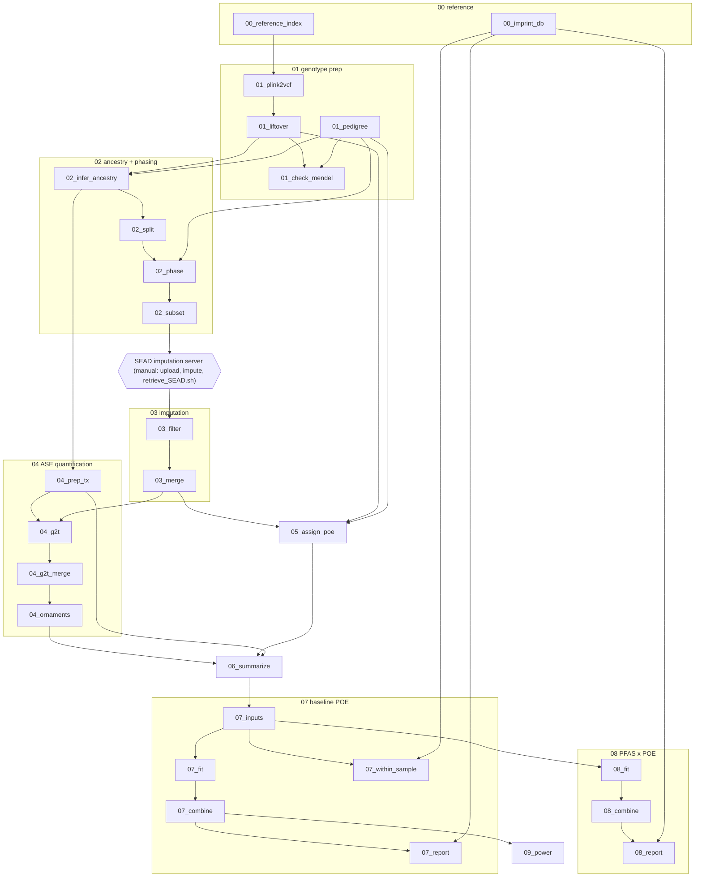

# Workflow: parent-of-origin expression and PFAS exposure in human placenta

This document explains how the scripts in this repository fit together, what
each stage does, what it needs, what it writes, and how to run the whole
analysis from raw genotypes and RNA-seq on an LSF cluster.

Contents

1. [Study design in one paragraph](#1-study-design-in-one-paragraph)
2. [Pipeline at a glance](#2-pipeline-at-a-glance)
3. [Before the first run](#3-before-the-first-run)
4. [Running the pipeline](#4-running-the-pipeline)
5. [Stage-by-stage methods](#5-stage-by-stage-methods)
6. [Shared R library](#6-shared-r-library)
7. [Outputs](#7-outputs)
8. [Resources and tuning](#8-resources-and-tuning)
9. [Design notes and caveats](#9-design-notes-and-caveats)
10. [Repository layout](#10-repository-layout)

---

## 1. Study design in one paragraph

GUSTO mother-father-infant trios are genotyped on the Illumina
OmniExpressExome-8 v1.2 array. Trios are lifted to GRCh38, assigned to
Chinese / Indian / Malay ancestry, phased with the pedigree (SHAPEIT5), and
the phased infants are imputed on the SEAD reference panel. The imputed
infant variants are projected onto a long-read placenta transcriptome
(ESPRESSO + SQANTI3), and each infant's placental short-read RNA-seq is
quantified allele-specifically against a personalised transcriptome
(Ornaments). The parents' genotypes then tell which infant haplotype is
maternal and which is paternal, turning haplotype-specific counts into
maternal / paternal counts per transcript-SNP and gene-SNP. Negative-binomial
mixed models estimate the cohort-level parent-of-origin effect (POE) for each
gene and transcript (stage 07) and how that effect changes with maternal or
cord-blood PFAS concentrations and gestational diabetes (stage 08).

## 2. Pipeline at a glance



Stage 10 (mediation simulation) is independent of the data and runs on its own
(`./run_pipeline.sh sim`).

### Step registry

Every step is one LSF job or one LSF job array. `./run_pipeline.sh list`
prints this table from the registry in `run_pipeline.sh`.

| Step | Script | Array (one element per) | Depends on | Group |
|---|---|---|---|---|
| 00_reference_index | 00_reference/reference_index.lsf | - | - | all |
| 00_imprint_db | 00_reference/imprint_db.lsf | - | - | all |
| 01_pedigree | 01_genotype_prep/pedigree.lsf | - | - | all |
| 01_plink2vcf | 01_genotype_prep/plink2vcf.lsf | - | 00_reference_index | all |
| 01_liftover | 01_genotype_prep/liftover.lsf | - | 01_plink2vcf | all |
| 01_check_mendel | 01_genotype_prep/check_mendel.lsf | - | 01_liftover, 01_pedigree | all |
| 01_manifest_qc | 01_genotype_prep/qc/manifest_qc.lsf | - | 00_reference_index | qc |
| 02_infer_ancestry | 02_ancestry_phasing/infer_ancestry.lsf | - | 01_liftover, 01_pedigree | all |
| 02_split | 02_ancestry_phasing/split_by_ancestry.lsf | ancestry group | 02_infer_ancestry | all |
| 02_phase | 02_ancestry_phasing/phase.lsf | group x autosome | 02_split, 01_pedigree | all |
| 02_subset | 02_ancestry_phasing/subset_by_role.lsf | ancestry group | 02_phase | all |
| *(manual)* | 03_imputation_SEAD/retrieve_SEAD.sh | - | SEAD server | - |
| 03_filter | 03_imputation_SEAD/filter_sead.lsf | group x autosome | SEAD files present | all |
| 03_merge | 03_imputation_SEAD/merge_sead.lsf | autosome | 03_filter | all |
| 03_qc | 03_imputation_SEAD/imputation_qc.lsf | - | 03_merge | qc |
| 04_prep_tx | 04_ornaments_ase/prep_transcriptome.lsf | - | 02_infer_ancestry | all |
| 04_g2t | 04_ornaments_ase/g2t_vcf.lsf | autosome | 03_merge, 04_prep_tx | all |
| 04_g2t_merge | 04_ornaments_ase/g2t_merge.lsf | - | 04_g2t | all |
| 04_ornaments | 04_ornaments_ase/ornaments.lsf | RNA-seq infant | 04_g2t_merge | all |
| 04_txomic_stats | 04_ornaments_ase/txomic_stats.lsf | - | 04_g2t_merge | qc |
| 05_assign_poe | 05_parental_origin/assign_poe.lsf | - | 03_merge, 01_liftover, 01_pedigree | all |
| 06_summarize | 06_feature_matrices/summarize.lsf | level (gene, transcript) | 04_ornaments, 05_assign_poe, 04_prep_tx | all |
| 07_inputs | 07_poe_baseline/model_inputs.lsf | - | 06_summarize | all |
| 07_within_sample | 07_poe_baseline/within_sample.lsf | - | 07_inputs, 00_imprint_db | all |
| 07_fit | 07_poe_baseline/fit_baseline.lsf | feature batch | 07_inputs | all |
| 07_combine | 07_poe_baseline/combine_baseline.lsf | - | 07_fit | all |
| 07_report | 07_poe_baseline/baseline_report.lsf | - | 07_combine, 00_imprint_db | all |
| 08_fit | 08_pfas_interaction/fit_interaction.lsf | feature batch | 07_inputs | all |
| 08_combine | 08_pfas_interaction/combine_interaction.lsf | - | 08_fit | all |
| 08_report | 08_pfas_interaction/interaction_report.lsf | - | 08_combine, 00_imprint_db | all |
| 09_power | 09_power/power.lsf | - | 07_combine | all |
| 10_sim | 10_mediation_sim/sim.lsf | simulated study | - | sim |
| 10_aggregate | 10_mediation_sim/aggregate.lsf | - | 10_sim | sim |

## 3. Before the first run

### 3.1 Software

| Tool | Used in | Configured by |
|---|---|---|
| LSF (`bsub`, `bjobs`) | job submission | `config/resources.sh` (queues) |
| bcftools >= 1.16, tabix, bgzip | 01-05 | `BCFTOOLS_ENV` (conda env) |
| bcftools build with the `+liftover` plugin | 01_liftover | `LIFTOVER_BCFTOOLS` |
| PLINK 1.9 | 01 | `PLINK_MODULE` |
| samtools | 00 | `SAMTOOLS_ENV` |
| SHAPEIT5 (`SHAPEIT5_phase_common`) | 02_phase | `SHAPEIT5_VENV` |
| Ornaments (`ornaments`, g2t conversion) | 04 | `ORNAMENTS_VENV` |
| Python >= 3.8 with pysam | 01 QC, 05 | `PYTHON_ENV` |
| R >= 4.3 (run via Singularity image) | 00, 02-04, 06-10 | `RSTUDIO_SIF`, `R_LIB_DIR`, `SING_BIND` |
| wget | manual SEAD download | - |

R packages: glmmTMB, data.table, dplyr, tidyr, purrr, forcats, stringr,
tibble, ggplot2, ggrepel, scales, patchwork, BiocParallel, optparse, readxl,
SNPRelate, class, boot, lavaan, dagitty, biomaRt (Bioconductor).

### 3.2 Configuration

All paths and environment names live in `config/paths.sh`; all LSF resources
in `config/resources.sh`. Every value is a default that can be overridden by
exporting the variable before calling `run_pipeline.sh`. R scripts read the
same variables through `R/setup.R`, so there is one place to edit.

Typical first edit: set `LAB_DIR`, `SCRATCH_DIR`, the software environment
names, and the paths in the *GUSTO inputs* and *references* blocks.

### 3.3 Required inputs

| Variable | Content |
|---|---|
| `TRIOS_DIR/<PLINK_PREFIXES>.{bed,bim,fam}` | PLINK binaries for infants, mothers, fathers (hg19, TOP-strand alleles) |
| `HG19_FASTA`, `HG38_FASTA`, `HG19_TO_HG38_CHAIN` | reference genomes (hg19 chr-prefixed) and liftover chain |
| `GENETIC_MAP_DIR/chr<N>.b38.gmap.gz` | GRCh38 genetic maps (SHAPEIT format) |
| `INFANT_META_CSV` | infants with placental RNA-seq: SubjectID, maternal ethnicity |
| `FASTQ_DIR/J<fastq id>_{1,2}.fq.gz`, `FASTQ_ID_MAP` | paired-end placental RNA-seq; map `<SubjectID> <fastq id>` |
| `TX_FASTA`, `TX_GTF`, `TX_CLASSIF` | long-read placenta transcriptome (ESPRESSO sequences, GTF, SQANTI3 classification) |
| `RNASEQ_COVARS_CSV` | RNA-seq covariates: SubjectID, sex, mother_ethnicity, GA, gdm |
| `PFAS_MAT_CSV`, `PFAS_CHILD_CSV` | SubjectID + 8 PFAS (PFBA PFOA PFNA PFDA PFUnDA PFBS PFHxS PFOS) with `_mat` / `_child` suffixes, first 9 columns |
| `PFAS_MAT_COHORT_XLSX`, `PFAS_CORD_COHORT_XLSX` | whole-cohort PFAS tables (dose-response annotation only) |
| `ARRAY_MANIFEST`, `DBSNP_*_VCF` | only for the optional manifest QC |
| `EXCLUDE_SAMPLES_FILE` | optional; one sample ID per line, removed from every model |

Sample naming: PLINK writes VCF sample IDs as `FID_IID`. IIDs start with `B`
(infant), `M` (mother) or `P` (father); the infant's FID is the GUSTO
SubjectID. Model sample IDs are `<SubjectID>_B<SubjectID>` with `-` replaced by
`_`.

**PFAS scale.** PFAS values enter the interaction models exactly as they appear
in `PFAS_*_CSV` (no log transform, no standardisation inside the pipeline).
Decide the scale before the first run (for example log2 ng/mL) and write the
CSVs accordingly; `beta_int` is per unit of whatever scale is supplied.

## 4. Running the pipeline

```bash
cd placenta-poe-pfas

./run_pipeline.sh all              # dry run: prints the bsub plan, submits nothing
./run_pipeline.sh --submit all     # queue every main step with LSF dependencies
./run_pipeline.sh status           # receipts done / expected and active jobs per step
./run_pipeline.sh list             # the step registry
```

Targets can be a step (`02_phase`), a stage number (`07`), `all`, `qc`
(optional QC steps) or `sim` (stage 10). Several targets can be combined.

| Option | Effect |
|---|---|
| `--submit` | actually submit (default is a dry run) |
| `--force` | ignore receipts and rerun every selected element |
| `--pilot N` | submit at most N elements of each selected array step |
| `--lenient` | start downstream steps when upstream jobs end (`ended()`) rather than only after every element succeeded (`done()`) |
| `--tag NAME` | job-name prefix (default `poe`) so two copies can run side by side |

**Resume.** Each finished job or array element writes
`RUN_DIR/receipts/<step>.<index>.ok`. Steps with all receipts are skipped and
array steps resubmit only missing elements, so rerunning the same command
resumes after failures. Delete a receipt (or use `--force`) to redo work.

### 4.1 The SEAD imputation step (manual)

The SEAD server is external, so the pipeline pauses there:

1. `./run_pipeline.sh --submit all` runs stages 00-02 and writes the phased
   infant VCFs to `SEAD_UPLOAD_DIR/<group>/<group>_chr<N>.vcf.gz`. Steps that
   need imputed data are not submitted while the SEAD results are missing.
2. Upload each ancestry group to the SEAD server (GRCh38, Rsq >= 0.3 filter).
3. Save the download links of each finished job to
   `config/sead_urls_<group>.txt` (gitignored; the links contain access tokens) and run on
   a login/transfer node:
   `REPO=$PWD bash 03_imputation_SEAD/retrieve_SEAD.sh <group> config/sead_urls_<group>.txt`
4. Once every `SEAD_DOWNLOAD_DIR/<group>_SEAD/chr<N>.SEAD.GRCh38.dose.vcf.gz`
   exists, run `./run_pipeline.sh --submit all` again; finished steps are skipped
   and the pipeline continues from stage 03.

### 4.2 Other manual points

* `00_imprint_db` queries Ensembl through biomaRt and needs internet access.
  If compute nodes are offline, run `REPO=$PWD Rscript 00_reference/imprintDB.R`
  on a login node, then `touch $RUN_DIR/receipts/00_imprint_db.1.ok`.
* Ornaments is the most expensive step. Run a pilot first (section 8).

### 4.3 A full run from raw data

```bash
./run_pipeline.sh --submit all qc          # stages 00-02 (+ manifest QC)
#   ... SEAD upload, imputation, retrieve_SEAD.sh for each group ...
./run_pipeline.sh --submit 04_ornaments --pilot 2   # optional resource pilot
./run_pipeline.sh --submit all qc          # stages 03-09
./run_pipeline.sh --submit sim             # stage 10, independent
./run_pipeline.sh status
```

Logs go to `LOG_DIR/<step>.<jobid>.<index>.{out,err}`.

## 5. Stage-by-stage methods

### Stage 00 - references

* **reference_index** indexes the hg19 and GRCh38 FASTA files.
* **imprintDB.R** maps a curated list of imprinted-gene symbols and aliases to
  Ensembl gene IDs (`IMPRINT_DB`) and builds an Ensembl ID to symbol table for
  every gene in the placenta transcriptome (`PLACENTA_DB`).

### Stage 01 - genotype preparation

* **prep_ped.R / pedigree.lsf**: infant-centred trio pedigree from the three
  `.fam` files (`TRIO_PED`: FID IID PID MID SEX PHENO, `0` = parent not
  genotyped), then `make_shapeit5_fam.sh` writes the SHAPEIT5 pedigree
  (`offspring father mother`, `NA` for a missing parent) using VCF IDs
  (`FID_IID`; set `ID_MODE=iid` if the VCF uses bare IIDs).
* **plink2vcf.lsf**: PLINK 1.9 merge of the three files (SNPs with conflicting
  alleles across files are dropped), autosomes only, chr-prefixed VCF;
  `bcftools +fixref -m top` converts Illumina TOP strand to the hg19 forward
  strand; `bcftools norm --check-ref x` drops remaining mismatches.
* **liftover.lsf**: drop sites invariant across all trio members, lift hg19 to
  GRCh38 with `bcftools +liftover`, sort, split/deduplicate, keep biallelic SNPs
  whose REF matches GRCh38 (`TRIO_VCF_HG38`).
* **check_mendel.lsf**: PLINK `--mendel` error rates per trio, individual and
  SNP (QC report, not a filter).
* **qc/manifest_qc.lsf** (optional): aligns the array manifest to hg19 and
  records which SNPs needed a swap or strand flip.

Genotyping and array-level QC are described in `reports/genotype_methods.md`.

### Stage 02 - ancestry and phasing

* **infer_ancestry.R**: PCA (SNPRelate) on LD-pruned autosomal SNPs in infants.
  Infants with reported maternal ethnicity (the RNA-seq subset) train a 3-nearest
  neighbour classifier on PC1/PC2 that labels the remaining infants; parents
  inherit their infant's label. Writes `samples_<group>.txt` per group.
* **split_by_ancestry.lsf**: per group, recompute site statistics and keep
  biallelic SNPs with missingness <= 0.05, MAF >= 0.05, HWE p >= 1e-6; one BCF
  per autosome.
* **phase.lsf**: SHAPEIT5 `phase_common` with the trio pedigree and GRCh38
  genetic map, per group and chromosome.
* **subset_by_role.lsf**: phased infants to bgzipped VCFs for SEAD upload;
  unphased mothers and fathers kept per chromosome.

### Stage 03 - SEAD imputation

* **retrieve_SEAD.sh** (manual, see 4.1).
* **filter_sead.lsf**: keep biallelic imputed sites with MAF > 0.01 (the server
  has applied Rsq >= 0.3).
* **merge_sead.lsf**: merge the three ancestry groups per chromosome (union of
  sites; genotypes absent from a group are missing) into `IMPUTED_DIR`.
* **imputation_qc** (optional): site counts before and after filtering, variant
  density per kb, imputed MAF and R2 distributions.

### Stage 04 - allele-specific quantification

* **prep_transcriptome.lsf**: list the VCF IDs of infants with RNA-seq
  (`INFANT_SAMPLES`) and add 5'->3' `exon_number` attributes to the transcriptome
  GTF (required by Ornaments).
* **g2t_vcf.lsf**: project imputed genomic variants onto transcript coordinates
  (Ornaments), keeping heterozygous sites.
* **g2t_merge.lsf**: merge chromosomes for the RNA-seq infants, write a valid
  header (one contig per transcript), bgzip and index.
* **ornaments.lsf**: per infant, extract its phased heterozygous transcriptomic
  variants, build a personalised transcriptome and index, and run
  `ornaments quant` on the paired-end placental RNA-seq. Index files are removed
  after quantification unless `KEEP_TXOME_INDEX=1`.
* **txomic_stats** (optional): heterozygous variants per transcript.

### Stage 05 - parental origin of infant haplotypes

`assign_POE.py`, per chromosome and infant:

1. parental panel = biallelic SNPs genotyped in nearly all parents;
2. informative sites = panel sites where the mother and father are homozygous
   for different alleles (REF/ALT must agree between the trio VCF and the
   imputed infant VCF);
3. at each informative site where the infant is a phased heterozygote, the left
   haplotype votes maternal if it carries the mother's allele, otherwise
   paternal. Majority wins; ties are `undefined`.

Output `HAP_ORIGIN` has one row per chromosome and columns `<ID>_L`, `<ID>_R`;
`HAP_ORIGIN.votes.tsv` records the vote counts.

### Stage 06 - maternal / paternal count matrices

`ornaments_summarizeToGene.R --level gene|transcript`, per sample:

1. within-gene transcript usage weights `w_t = TPM_t / sum TPM` (equal weights if
   all transcripts of a gene have TPM 0);
2. Ornaments haplotype counts (L, R) to maternal / paternal using `HAP_ORIGIN`
   for that chromosome (undefined haplotypes contribute 0);
3. transcript level: feature = `transcript:tx_pos`;
   gene level: transcript positions are mapped back to genomic SNPs and
   feature = `gene:chr:pos`, count = sum over the gene's transcripts carrying
   that SNP of `w_t x count_t`.

Columns are `<sample>_maternal`, `<sample>_paternal`; absent features are 0.

### Stage 07 - baseline parent-of-origin effects

* **model_inputs.R**: joins covariates and PFAS tables; modelled samples are
  those present in the counts and metadata, not excluded, with non-missing sex
  and ancestry. Codes each condition in `POE_CONDITIONS` (continuous or binary),
  computes median-of-ratios size factors over maternal + paternal counts,
  filters features (>= 3 SNPs, >= 15 samples, >= 50 total counts), and splits
  features into `N_BATCHES_GENE` + `N_BATCHES_TX` balanced batches of long
  tables.
* **fit_baseline.R** (array): per feature, glmmTMB negative binomial (nbinom2)

  `count ~ allele + sex + ancestry + (1|SNPpos) + (1|sample_id) + offset(log SF)`

  `beta` = log(paternal / maternal) expression ratio. Counts are rounded.
* **combine_baseline.R**: gathers all batches (fails if any is missing) and
  applies Benjamini-Hochberg within each level.
* **baseline_report.R**: significance tier = BH q < 0.10 and the 95% CI of
  `beta` entirely outside +/- log(1.5) (60:40 allelic ratio). Volcano, forest,
  p-value, QQ and observed-vs-predicted calibration plots; transcript-gene
  overlap; Fisher test for enrichment of known imprinted genes among POE genes.
* **within_sample.R**: per sample, exact binomial test of maternal vs paternal
  counts per SNP, ACAT-combined per feature (count weights), BH within sample.
  A feature is biased in a sample if q < 0.05 and maternal ratio < 0.1 or > 0.9.

### Stage 08 - PFAS / GDM x parent-of-origin interaction

* **fit_interaction.R** (array, same batches as stage 07): per feature and
  condition X (samples with missing X dropped),

  `count ~ allele * X + ancestry + sex + (1|SNPpos) + (1|sample_id) + offset(log SF)`

  `beta_int` = change in the POE log-ratio per unit of X. For continuous X the
  POE is also reported at X = 0, at +1 SD, at the mean and mean + 1 SD of the
  modelled samples, and along a dose grid of -8..8 (delta-method 95% CIs).
  Binary X (GDM) reports the POE in each group. Each feature uses a seed derived
  from its ID, so results do not depend on batch layout.
* **combine_interaction.R**: BH within each level x condition.
* **interaction_report.R**: tiers via `classify_poe_nbmm_diff`; hits = q_int < 0.10
  and |beta_int| > log(1.5). Volcano, p-value, QQ and forest plots per condition,
  hit summaries for every condition, overlap with imprinted genes, gene-transcript
  overlap, bar charts of strict hits per PFAS (maternal and cord).
* **dose_response.R**: for conditions in `DOSE_RESPONSE_CONDITIONS`, predicted
  maternal allelic ratio across the exposure range for each hit, cohort-centred
  (annotated with the whole-cohort mean / SD) and centred on the modelled samples.

### Stage 09 - power

* **power_analysis.R**: power of the baseline POE test versus sample size,
  simulated from the observed baseline standard errors (scaled by sqrt(n0/N)),
  for a fraction pi1 in {0.5%, 1%, 2%} of features carrying a true effect of
  ratio 1.5-1.8, discoveries at BH q < 0.10 and |beta| >= log(1.5), 1000 studies
  per scenario. Runs for both levels.
* **power_plot.R**: power to detect allelic imbalance and its change with
  exposure by allele-specific read depth, from the Bayesian ASE simulation summary
  shipped in `09_power/`.

### Stage 10 - mediation simulation (independent)

`PFAS_imprinting_sim.R` simulates null studies (n = 100, 1000 isoforms) of the
planned PFAS -> imprinted isoform -> outcome (SRS) mediation analysis and
compares the type-I error of SEM (lavaan, bootstrap), CoCA, PGC and an adjusted
linear model. Array element r uses seed r. `aggregate_PFAS_sim_results.R`
summarises type-I error across runs; `DAG.R` draws the analysis DAG.

## 6. Shared R library

R drivers start with `source(file.path(Sys.getenv("REPO"), "R/setup.R"))`.

| File | Content |
|---|---|
| `R/setup.R` | imports `config/paths.sh` into R; `P()` path lookup, `words()`, `fig()`, `out()`, `NCPU`, `load_poe_library()` |
| `R/utils.R` | readers for count matrices, transcript-gene map, Ensembl tables; symbol conversion; sample exclusion |
| `R/poe_nbmm.R` | size factors, feature filters, long tables, baseline and interaction NB-GLMM fits, condition coding, batching, per-feature seeds |
| `R/poe_within_sample.R` | binomial + ACAT within-sample tests |
| `R/poe_classify.R` | significance tiers (baseline and interaction) |
| `R/poe_plots.R` | volcano, forest, p-value, bar plots |
| `R/poe_calibration.R` | QQ and observed-vs-predicted calibration plots |

Shell job scripts source `bin/job_env.sh`, which provides `log`, environment
activation helpers, `rscript` (Rscript inside the Singularity image), array
index helpers and `receipt`.

## 7. Outputs

| Location | Main files |
|---|---|
| `TRIOS_DIR/merged/` | `trios_hg19.vcf.gz`, `trios_hg38.vcf.gz`, Mendel QC |
| `ANCESTRY_DIR/` | `samples_<group>.txt`, `ancestry_assignments.tsv` |
| `IMPUTED_DIR/` | `chr<N>.biallelic.filtered.vcf.gz` |
| `QUANT_DIR/<sample>/` | Ornaments allele counts and TPMs |
| `HAP_ORIGIN` | parental origin of infant haplotypes |
| `POE_GENE_COUNTS`, `POE_TX_COUNTS` | maternal / paternal count matrices |
| `MODEL_DIR/` | `model_inputs.rds`, `model_metadata.rds`, `poe_nbmm_results_<level>.rds`, `poe_tiers_<level>.rds`, `poe_by_condition_<level>_<cond>.rds`, `poe_diff_tiers.rds`, `within_sample_tests.rds` |
| `WORK_DIR/` | TSV tables: model input summaries, baseline results and hits, imprinting enrichment, interaction results (`poe_interaction_all.tsv.gz`, `poe_interaction_hits.tsv`, `poe_interaction_hit_summary.tsv`), power tables, simulation type-I error |
| `FIG_DIR/` | PNG figures; `interaction/` and `dose_response/` subfolders |

## 8. Resources and tuning

`config/resources.sh` sets wall time, cores and memory per step
(`RES_<step>`) and array concurrency (`ARR_<step>`). Job scripts read the
cores actually granted (`LSB_DJOB_NUMPROC`), so changing `-n` is the only edit
needed to scale a step. To size Ornaments (or any array step):

```bash
./run_pipeline.sh --submit 04_ornaments --pilot 2
tools/lsf_usage_report.sh 04_ornaments      # peak memory and run time per job
# edit RES_04_ornaments, then submit the rest:
./run_pipeline.sh --submit 04_ornaments
```

Model batch counts (`N_BATCHES_GENE`, `N_BATCHES_TX`) control how many array
elements stages 07-08 use; changing them requires rerunning `07_inputs`.

## 9. Design notes and caveats

* **PFAS scale** is whatever the input CSVs contain (section 3.3). The dose grid
  of the cohort-centred dose-response plot is in those units; the subset-centred
  plot is in SDs of the modelled samples.
* **Effect-size threshold.** Baseline and interaction hits use log(1.5)
  (a 60:40 allelic ratio). Stricter thresholds such as log(2.33) (70:30) or
  log(2.5) can be applied to the saved results with `classify_poe_nbmm()`.
* **Covariates.** Models adjust for sex and ancestry. Gestational age is read
  into the metadata but is not in the model formulas.
* **Size factors** are computed once on all modelled samples and reused for
  every condition.
* **Haplotype origin** is assigned per chromosome. Infants homozygous at an
  informative site and sites whose alleles differ between the trio and imputed
  VCFs do not vote; haplotypes with tied votes are `undefined` and contribute
  no counts.
* **Ancestry** for infants without reported ethnicity comes from a 3-NN
  classifier on two PCs; check `ancestry_assignments.tsv` and the PCA figure.
* **Phasing** uses SHAPEIT5 `phase_common` with the trio pedigree. Check that the
  pedigree IDs match the VCF sample IDs (`ID_MODE`, section 5, stage 01).
* **Within-sample tests** are descriptive; cohort-level inference comes from the
  NB-GLMMs.
* **Reports.** The HTML reports in `docs/reports/` are rendered documents. The
  figure-based Rmds in `reports/` read PNGs from `reports/figures/`, listed in
  `reports/figures/MANIFEST.tsv` and staged with `reports/stage_figures.sh`
  from the pipeline's `FIG_DIR` or the local project folder; `figure5.png` of
  the methods report has no pipeline source (see `reports/README.md`).

## 10. Repository layout

```
placenta-poe-pfas/
  run_pipeline.sh          LSF submitter (dry run by default)
  config/paths.sh          paths, environments, analysis parameters
  config/resources.sh      LSF resources per step
  bin/job_env.sh           shared helpers for job scripts
  R/                       shared R library
  00_reference/ ... 10_mediation_sim/   one folder per stage
  tools/lsf_usage_report.sh
  reports/                 Rmd sources and genotype methods
  book/                    bookdown source of the project site
  docs/                    rendered site (GitHub Pages) + HTML reports
```
